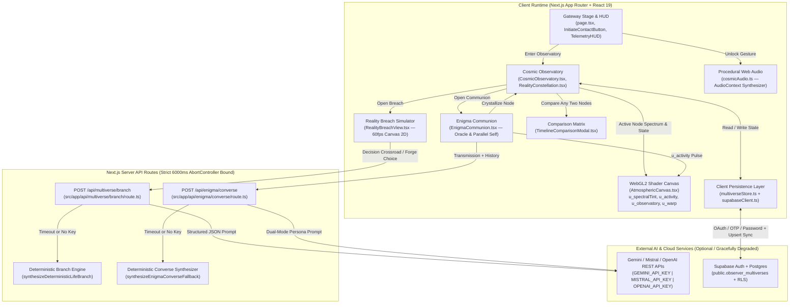

# VENJIX // THE MULTIVERSE OBSERVATORY

> *"Every unmade decision still echoes in an adjacent coordinate. Step into the breach, bend its physical laws, and observe what your other life became."*

**[Product Requirements Document](./docs/PRD.md)** · **[Architecture & Data Flow](#architecture--data-flow)** · **[Tech Stack](#tech-stack)** · **[Quickstart & Local Setup](#quickstart--local-setup)**

---

**VENJIX** is an interactive sci-fi observatory and personal multiverse simulator built with Next.js App Router, raw WebGL2 domain-warped GLSL shaders, procedural HTML5 Canvas physics simulations, native Web Audio synthesis, multi-provider AI branching, and Supabase cloud persistence.

Rather than presenting a static form or generic chat UI, VENJIX lets users map their baseline life context, crystallize pivotal *"what if?"* choices into luminous orbital Reality Orbs, step inside interactive multi-epoch dimensional simulations, converse directly with their Parallel Self or The Enigma oracle, and compare parallel life trajectories side by side.

---

## Core Experience & Feature Matrix

| Subsystem | Key Modules | Capabilities |
| :--- | :--- | :--- |
| **Awakening Gateway & Dynamic WebGL2 Shader** | [`AtmosphericCanvas.tsx`](./src/components/gateway/AtmosphericCanvas.tsx)<br>[`InitiateContactButton.tsx`](./src/components/gateway/InitiateContactButton.tsx)<br>[`TelemetryHUD.tsx`](./src/components/gateway/TelemetryHUD.tsx)<br>[`page.tsx`](./src/app/page.tsx) | • 4-stage choreographed entry sequence (`0.0s`–`7.8s`) with session persistence and OAuth callback bypass.<br>• Full-screen WebGL2 (`GLSL ES 3.00`) 5-octave `fbm()` and 6-octave `ridgedMF()` domain-warped nebula.<br>• Smooth `requestAnimationFrame` uniform interpolation (`u_spectralTint`, `u_activity` at `~0.03` per 60fps frame; `u_observatory`, `u_warp`, `u_reveal`), capped `2.0x` DPR, and `prefers-reduced-motion` support. |
| **Cosmic Observatory & Synaptic Constellation** | [`CosmicObservatory.tsx`](./src/components/observatory/CosmicObservatory.tsx)<br>[`RealityConstellation.tsx`](./src/components/observatory/RealityConstellation.tsx)<br>[`RealityInspector.tsx`](./src/components/observatory/RealityInspector.tsx)<br>[`ObservatoryNavbar.tsx`](./src/components/observatory/ObservatoryNavbar.tsx)<br>[`realityData.ts`](./src/components/observatory/realityData.ts) | • Interactive `1000 × 620` orbital graph connecting 5 core anchor nodes (`OMEGA-01`, `CHRONO-04`, `NULL-09`, `AETHER-12`, `MYTHOS-07`) and up to `5` user-crystallized branches (`MAX_CUSTOM_REALITIES = 5`).<br>• Curved SVG cubic Bezier synaptic threads with flowing harmonic pulse packets.<br>• Hovering or selecting a Reality Orb shifts background shader hue (`u_spectralTint`) smoothly in real time. |
| **Life-Choice Branching Engine & Reality Breach** | [`RealityBreachView.tsx`](./src/components/observatory/RealityBreachView.tsx)<br>[`branchEngine.ts`](./src/lib/multiverse/branchEngine.ts)<br>[`/api/multiverse/branch`](./src/app/api/multiverse/branch/route.ts) | • Step inside a 2D Canvas dimensional simulation running 5 core physics engines (`bifurcation_horizon`, `astral_astrolabe`, `inverted_entropy`, `dyson_harmonic`, `obsidian_glass_sea`) or `procedural_hybrid`.<br>• Scrub across synchronized life epochs (`DAY 01`, `+1 YR`, `+5 YRS`, `+10 YRS`), inspect spatial anomalies, select mid-timeline Decision Crossroads, and mutate physical laws (`entropyRate`, `gravityPolarity`, `coherenceFactor`, `temporalDrift`) live. |
| **The Enigma Communion** | [`EnigmaCommunion.tsx`](./src/components/observatory/EnigmaCommunion.tsx)<br>[`/api/enigma/converse`](./src/app/api/enigma/converse/route.ts) | • Dual-channel conversational terminal supporting **`enigma_oracle`** (cosmological observatory voice) and **`parallel_self`** (first-person dialogue with a divergent version of yourself).<br>• Couples live transmission state into the WebGL2 `u_activity` uniform (`0.0` idle → `0.42` transmitting → `1.0` synthesizing).<br>• Persists Echo Logs and crystallizes speculative insights directly into new Reality Nodes. |
| **Parallel Life Comparison Matrix** | [`TimelineComparisonModal.tsx`](./src/components/observatory/TimelineComparisonModal.tsx)<br>[`comparisonEngine.ts`](./src/components/observatory/comparisonEngine.ts) | • Side-by-side comparison of any two Reality Nodes / branched lives across all 4 temporal epochs.<br>• Overlaid 4-axis radar telemetry (`Fulfillment`, `Wealth`, `Mastery`, `Freedom`) with numeric deltas, deterministic **Nexus Verdict**, and direct `[ ENTER BREACH → ]` jump actions. |
| **Procedural Web Audio Soundscape** | [`cosmicAudio.ts`](./src/lib/cosmicAudio.ts) | • Zero-dependency native `AudioContext` engine unlocked strictly on user gesture.<br>• Generates an ambient harmonic drone (`55 Hz` + `82.5 Hz` + `110 Hz` detuned oscillators through a low-pass `BiquadFilterNode`) plus orb hover chimes, dimensional breach sweeps, and Enigma transmission ticks. |
| **Offline-First & Supabase Cloud Sync** | [`ObserverIdentityModal.tsx`](./src/components/observatory/ObserverIdentityModal.tsx)<br>[`multiverseStore.ts`](./src/lib/multiverseStore.ts)<br>[`supabaseClient.ts`](./src/lib/supabaseClient.ts) | • Instant zero-config `localStorage` persistence (`venjix_multiverse_store_v1`) with `.json` multiverse bundle export/import.<br>• Real `@supabase/supabase-js` authentication (Email/Password Sign In & Sign Up, Magic Link OTP, GitHub & Google OAuth) synced automatically to Postgres (`public.observer_multiverses`). |

---

## Architecture & Data Flow



---

## Tech Stack

| Layer | Technology | Version / Notes |
| :--- | :--- | :--- |
| **Framework** | Next.js (App Router) | `16.4.5` |
| **UI Runtime** | React & React DOM | `19.3.0` |
| **Language** | TypeScript | `^5` (strict mode) |
| **Styling** | Tailwind CSS | `^4` + custom `@theme` tokens (`#05050A` void, `#8C46FF` electric violet) |
| **Background Graphics** | WebGL2 (`GLSL ES 3.00`) | Zero external shader dependencies; `fbm` + `ridgedMF` domain-warped nebula |
| **Simulation & Charts** | HTML5 Canvas 2D + SVG | Custom physics modes (`RealityBreachView.tsx`) & radar/constellation overlays |
| **Audio Engine** | Web Audio API | Native browser `AudioContext`, oscillators, envelopes, and `BiquadFilterNode` |
| **AI Integration** | Multi-Provider REST | `fetch` + `6000ms` `AbortController` (Gemini, Mistral, OpenAI) + deterministic fallback |
| **Auth & Database** | `@supabase/supabase-js` | `^2.118.0` (Email/Password, Magic Link, GitHub/Google OAuth, Postgres + RLS) |

---

## Quickstart & Local Setup

### 1. Clone & Install

```bash
git clone <your-repository-url>
cd "Venjix (Multiverse)"
npm install
```

### 2. Configure Environment Variables (Optional for Local Play)

VENJIX runs **out of the box** without API keys using deterministic life-branch synthesis and `localStorage` persistence. To enable live LLM branching/dialogue and Supabase cloud sync, copy the template and fill in your credentials:

```bash
cp .env.example .env.local
```

```dotenv
# Optional AI Providers (evaluated via AbortController with 6000ms fallback)
GEMINI_API_KEY=your-gemini-api-key
MISTRAL_API_KEY=your-mistral-api-key
OPENAI_API_KEY=your-openai-api-key

# Optional explicit provider override: gemini | mistral | openai
# VENJIX_LLM_PROVIDER=gemini

# Optional Supabase Auth & Cloud Persistence
NEXT_PUBLIC_SUPABASE_URL=https://your-project-id.supabase.co
NEXT_PUBLIC_SUPABASE_ANON_KEY=your-supabase-anon-key
```

### 3. Provision Supabase Table & RLS (Required Only for Cloud Sync)

Run the following SQL in your Supabase SQL Editor to create the cloud persistence table queried by [`multiverseStore.ts`](./src/lib/multiverseStore.ts):

```sql
CREATE TABLE IF NOT EXISTS public.observer_multiverses (
  user_id UUID PRIMARY KEY REFERENCES auth.users(id) ON DELETE CASCADE,
  observer_handle TEXT NOT NULL DEFAULT 'OBSERVER-PRIME',
  baseline_context TEXT NOT NULL DEFAULT '',
  custom_realities JSONB NOT NULL DEFAULT '[]'::jsonb,
  custom_links JSONB NOT NULL DEFAULT '[]'::jsonb,
  echo_history JSONB NOT NULL DEFAULT '[]'::jsonb,
  updated_at TIMESTAMPTZ NOT NULL DEFAULT NOW()
);

ALTER TABLE public.observer_multiverses ENABLE ROW LEVEL SECURITY;

CREATE POLICY "Observers can read their own multiverse"
  ON public.observer_multiverses
  FOR SELECT
  USING (auth.uid() = user_id);

CREATE POLICY "Observers can insert their own multiverse"
  ON public.observer_multiverses
  FOR INSERT
  WITH CHECK (auth.uid() = user_id);

CREATE POLICY "Observers can update their own multiverse"
  ON public.observer_multiverses
  FOR UPDATE
  USING (auth.uid() = user_id)
  WITH CHECK (auth.uid() = user_id);
```

*(If using GitHub or Google OAuth, enable those providers under **Authentication → Providers** in Supabase and add `http://localhost:3000` plus your production domain to **Redirect URLs**.)*

### 4. Run Development & Verification Commands

```bash
# Start development server at http://localhost:3000
npm run dev

# Type-check & lint
npx tsc --noEmit
npm run lint

# Production build check (webpack pipeline)
npx next build --webpack
```

---

## Documentation

For deeper architectural specifications, target personas, data contracts, and non-functional budgets, see the full **[Product Requirements Document (`docs/PRD.md`)](./docs/PRD.md)**.
